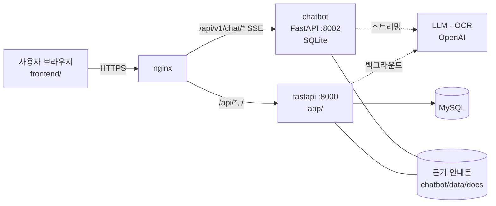

# GlowPass ✨ — 외국인 K-피부미용 사후관리 플랫폼

> OZ 코딩스쿨 AI 헬스케어 부트캠프 6기 · 파이널 프로젝트 4팀 · 참여기업 Uponati(어포나티)
> 한국에서 피부 시술·진료를 받은 외국인(1차 중국인)이 **자국어로** 처방·관리 방법을 이해하고, 귀국 후에도 궁금한 점을 물어볼 수 있게 돕는다.

**의료 안전선** — 정보 제공까지만 한다. 진단·처방·처방 변경·개인 맞춤 시술 추천은 하지 않고, 자료에 없는 내용은 지어내지 않으며(근거 안내문 + 출처 표시), 위험 신호가 보이면 119·응급실 안내를 먼저 띄운다.

## 주요 기능

| 기능 | 하는 일 | 참여기업 필수 |
|---|---|---|
| FR-01 진료기록 | 진료일·병원·시술·처방약 저장·조회·수정·삭제 (본인 것만) | |
| FR-05 처방전 OCR | 처방전·약봉투 사진 → 칸 자동 채우기 → 사용자가 확인 후 저장 | ✅ OCR |
| FR-02 근거 검색 | FDA·NHS 등 공식 자료를 요약한 안내문에서 관련 문서 찾기 — 운영은 감수(`reviewed: true`)된 안내문만 · 낱말 검색 (벡터·혼합은 평가 스크립트로 비교) | |
| FR-03 AI 가이드 | 진료기록 + 근거 안내문 → 복약·생활관리 가이드 (출처·면책 문구 포함) | ✅ LLM 가이드 생성 |
| FR-04 AI 챗봇 | 4개 언어 실시간 상담 (SSE 스트리밍, 이전 대화 반영, 응급·진단 요청 차단) | ✅ 실시간 챗봇 |
| 피드백 | 가이드·챗봇 답에 👍/👎 + 이유 → 관리자 집계로 안내문·프롬프트 개선 | |
| 위험 신호 기록 | 챗봇이 응급·진단 요청을 막으면 기록(`safety_alert`) → 병원 연락 요청에 이어 붙는다 | |
| 병원 연락 요청 | 병원 목록(추천·배정 없음)에서 사용자가 골라 연락 요청 → 병원 접수대 화면(`#/desk`, 관리자)에서 확인·완료 처리 | |
| 복약·관리 알림 | 복약 시간·가이드 확인 알림 등록, 화면이 열려 있으면 시간에 맞춰 알림 | |
| 다국어 | 한국어·日本語·中文(简体)·English, 해외 번호로 가입 · 가이드 읽어주기(음성)·이미지 카드 저장 | |

## 구조



- **같은 로그인 토큰**을 팀 API 와 챗봇이 함께 쓴다 (`LOGIN_SECRET_KEY = SECRET_KEY`).
- AI 가 오래 걸리는 작업(가이드 생성·OCR)은 **202 로 먼저 응답하고 백그라운드**에서 처리 → 화면은 결과를 조회 (P95 3초).
- 근거 안내문은 팀 API 와 챗봇이 **같은 파일**을 쓰고, 안전 규칙(`chatbot/app/safety.py`)도 함께 쓴다.

## API 한눈에 (`/api/v1`)

| 영역 | 메서드 · 경로 |
|---|---|
| 인증 | `POST /auth/signup` · `POST /auth/login` · `GET /auth/token/refresh` |
| 내 정보 | `GET /users/me` · `PATCH /users/me` · `DELETE /users/me` (회원 탈퇴 — 진료기록·가이드 등 함께 삭제) |
| 진료기록 | `POST/GET /medical-records` · `GET/PATCH/DELETE /medical-records/{id}` · `GET /medical-records/guide-context` |
| OCR | `POST /ocr/prescriptions` (202) · `GET /ocr/prescriptions/{job_id}` |
| AI 가이드 | `POST /guides` (202) · `GET /guides` · `GET /guides/{id}` · `GET /guides/{id}/sources` · `PUT /guides/{id}/feedback` · `GET /guides/feedback/summary` (관리자) |
| 챗봇 | `GET /chat/langs` · `POST /chat/conversations` · `POST /chat/conversations/{id}/stream` (SSE) · `GET /chat/conversations/{id}/messages` · `DELETE /chat/conversations/{id}` · `GET /chat/usage` · `PUT /chat/conversations/{id}/messages/{mid}/feedback` |
| 병원 · 연락 요청 | `GET /hospitals` · `POST/GET /hospital-contacts` · `GET/PATCH /hospital-contacts/{id}` (본인: 취소 · 관리자: 진행 중/완료) · `GET /hospital-contacts?scope=all` (관리자 접수대) |
| 위험 신호 | `GET /chat/safety-alerts` · `GET /chat/safety-alerts/{id}` |
| 리마인더 · 콘텐츠 · 서비스 정보 | `/reminders` · `/content-assets` · `GET /service-info` (데모 모드 표시용) |

자세한 요청·응답은 서버 실행 후 `/api/docs` (Swagger).

## AI 설정 (`.env`)

| 변수 | 값 | 설명 |
|---|---|---|
| `GUIDE_LLM_MODE` | `fake` / `openai` | 가이드 생성. fake 는 키·비용 없이 데모 |
| `OCR_MODE` | `fake` / `openai` | 처방전 인식 |
| `CHAT_LLM_MODE` · `CHAT_APP_ENV` | `fake`·`dev` / `openai`·`demo`(데모데이) 또는 `prod` | 챗봇 (demo·prod 에서는 fake 금지 · prod 에서는 감수 전 안내문도 금지) |
| `GUIDE_ALLOW_UNREVIEWED_DOCS` · `CHAT_ALLOW_UNREVIEWED_DOCS` | `true` / `false` | 감수 전 안내문을 근거로 쓸지 (데모데이까지 true + 화면에 '감수 전' 표시, 감수 후 false) |
| `OPENAI_API_KEY` | — | **`.env` 에만.** 공개 레포라 코드·커밋에 넣지 않는다 |

## 평가 기준 대응표

| 번호 | 항목 | 어디서 |
|---|---|---|
| 3-1 | 모델 성능 검증·개선 | `chatbot/eval/` 골든셋 + `chatbot/scripts/eval.py`·`eval_search.py`·`eval_emergency.py` (답·검색·응급 판정 품질 측정), 안전 규칙 테스트 |
| 3-2 | 비동기 추론 | 가이드·OCR 백그라운드 처리(202), 챗봇 SSE 스트리밍 |
| 3-3 | 결과 편차 최소화 | `temperature=0`, JSON 응답 형식, 챗봇: 같은 첫 질문 캐시 · 가이드: 같은 기록·언어·안내문 버전·모델이면 만든 가이드 재사용(`kb_version`), OCR 결과 값 정리(`clean_draft`) |
| 3-4 | 사용자 피드백 반영 구조 | 👍/👎 + 이유 → `GET /guides/feedback/summary` (근거 안내문·모델별 집계, 관리자 지정: `python -m app.commands.make_admin`) |
| 4-2 | 일관된 경험 | 4개 언어 같은 화면, 계정 언어 저장 |
| 5-1 | P95 3초 | `scripts/perf/measure_p95.py` — 사전 측정(개발 PC·가짜 AI) 전체 P95 621ms, 배포 후 재측정 |
| 5-2 | HTTP Method 분리 | 위 API 표 (조회 GET · 생성 POST · 일부 수정 PATCH · 평가 PUT · 삭제 DELETE) |
| 5-4 | 인증·인가 | JWT, 본인 데이터만(남의 것은 404), 관리자 집계 403 |
| 5-5 | 비동기 서버 | FastAPI + Tortoise ORM(async) + httpx(async) |

## 데모 시연 준비

```bash
# 서버를 켠 뒤 (가짜 데이터만 들어감 — 실제 환자 정보 금지)
DEMO_PASSWORD='원하는비밀번호' uv run python scripts/demo/seed_demo_day.py   # 시연 계정·기록·가이드·알림·연락 요청
uv run python -m app.commands.make_admin demo.staff@example.com            # 병원 접수대 역할 계정에 관리자 권한 (한 번만)
```

시연 순서는 [`docs/데모-시연-대본.md`](docs/데모-시연-대본.md), 알려진 한계와 배포 절차는 [`docs/배포-체크리스트.md`](docs/배포-체크리스트.md), EC2·Docker Hub 를 처음부터 마련해야 하면 [`docs/배포-준비-처음부터.md`](docs/배포-준비-처음부터.md).

---

## 🧰 개발 환경 (팀 템플릿)

## 🚀 주요 특징

- **FastAPI Framework**: 고성능 비동기 API 서버 구현.
- **AI Worker**: 모델 추론 및 학습 작업을 API 서버와 분리하여 처리.
- **UV Package Manager**: 매우 빠른 의존성 설치 및 가상환경 관리.
- **Tortoise ORM**: 비동기 방식의 데이터베이스 모델링 및 쿼리 관리.
- **Docker-Compose**: MySQL, Redis, Nginx를 포함한 전체 서비스 스택을 한 번에 실행.
- **CI/CD Scripts**: 코드 포맷팅(Ruff), 타입 체크(Mypy), 테스트(Pytest)를 위한 자동화 스크립트 제공.

---

## 📂 프로젝트 구조

```text
.
├── ai_worker/          # AI 모델 추론 및 학습 관련 코드 (Worker)
│   ├── core/           # 워커 설정 및 로거
│   ├── models/         # AI 모델 파일 보관 (PyTorch 등)
│   ├── tasks/          # 실제 처리할 작업 정의
│   └── main.py         # 워커 진입점
├── app/                # FastAPI 서버 코드
│   ├── apis/           # API 라우터 (v1 버전 관리)
│   ├── core/           # 서버 설정 (pydantic-settings), DB 설정, JWT, Validator 등 핵심 기능
│   ├── dtos/           # 데이터 전송 객체 (Pydantic models)
│   ├── models/         # DB 테이블 정의
│   ├── services/       # 비즈니스 로직
│   └── main.py         # FastAPI 애플리케이션 진입점
├── envs/               # 환경 변수 설정 파일 (.env)
├── infra/              # 인프라 설정 관련 디렉터리
│   ├── docker/         # Docker Compose 설정 (운영용)
│   └── nginx/          # Nginx 설정 파일 (리버스 프록시)
├── scripts/            # 배포 및 CI용 쉘 스크립트
├── docker-compose.yml  # 로컬 개발용 서비스 실행 설정
└── pyproject.toml      # uv 기반 의존성 관리 설정
```

---

## ⚙️ 사전 준비 사항

- **Python**: 3.13 이상 (로컬 개발 환경용)
- **UV**: Python 패키지 매니저 ([설치 가이드](https://github.com/astral-sh/uv))
- **Docker & Docker-Compose**: 전체 서비스 실행용

---

## 🛠️ 설치 및 설정

### 1. 가상환경 구축 및 의존성 설치

`uv`를 사용하여 프로젝트에 필요한 패키지를 설치합니다.

```bash
# 의존성 설치 (가상환경 자동 생성)
uv sync

# 특정 그룹의 의존성만 설치하려는 경우
uv sync --group app  # API 서버용
uv sync --group ai   # AI 워커용
```

### 2. 환경 변수 설정

`envs/` 디렉토리에 있는 예시 파일을 복사하여 `.env` 파일을 생성합니다.
- 로컬용 
    ```bash
    cp envs/example.local.env envs/.local.env
    ```
- 배포용 
    ```bash
    cp envs/example.prod.env envs/.prod.env
    ```

생성된 `env` 파일 내의 환경변수들은 프로젝트 상황에 맞게 수정하세요.

---

## 🏃 실행 방법

### 1. 로컬 및 개발 환경

#### Docker Compose로 전체 스택 실행

모든 서비스(API, Worker, DB, Redis, Nginx)를 한 번에 실행합니다.

```bash
docker-compose up -d --build
```

실행 후 다음 주소로 접속 가능합니다:
- **API 서버**: [http://localhost/api/docs](http://localhost/api/docs) (Swagger UI)
- **Nginx**: 80 포트를 통해 API 서버로 요청을 전달합니다.

#### 로컬에서 개별 실행 (개발용)

**FastAPI 서버 실행:**
```bash
uv run uvicorn app.main:app --reload
# or
docker compose up -d --build app
```

**AI Worker 실행:**
```bash
uv run python -m ai_worker.main
# or
docker compose up -d --build ai_worker
```

### 2. EC2 배포 환경 (Production)

제공된 쉘 스크립트를 사용하여 AWS EC2 환경에 이미지를 빌드, 푸시 및 배포할 수 있습니다.

#### 사전 준비
- EC2 인스턴스 (Ubuntu 권장)
- SSH 키 페어 (`~/.ssh/` 경로에 위치)
- 도커 허브(Docker Hub) 계정 및 Personal Access Token
- 배포용 환경 변수 설정 (`envs/.prod.env`)
- 도메인 구매 (Gabia, GoDaddy, AWS Route53 등)

#### 자동 배포 스크립트 실행
`scripts/deployment.sh`는 도커 이미지 빌드, 레포지토리 푸시, EC2 접속 및 컨테이너 실행 과정을 자동화합니다.

```bash
chmod +x scripts/deployment.sh
./scripts/deployment.sh
```
스크립트 실행 시 다음 정보를 입력해야 합니다:
1. 도커 허브 계정 정보 (Username, PAT)
2. 이미지를 업로드할 레포지토리 이름
3. 배포할 서비스 선택 (FastAPI, AI-Worker) 및 버전(Tag)
4. SSH 키 파일명 및 EC2 IP 주소
5. https 사용여부
   - 5-1. https인 경우 도메인 추가 입력  

#### SSL(HTTPS) 설정 (Certbot)
도메인을 연결하고 HTTPS를 적용하려면 `scripts/certbot.sh`를 사용합니다.

```bash
chmod +x scripts/certbot.sh
./scripts/certbot.sh
```
1. 도메인 주소 및 이메일 입력
2. SSH 키 파일명 및 EC2 IP 주소 입력
3. Let's Encrypt를 통한 인증서 발급 및 Nginx 설정 자동 갱신 적용

---

## 🧪 테스트 및 품질 관리

제공된 스크립트를 사용하여 코드의 품질을 검증할 수 있습니다.

```bash
# 테스트 실행
./scripts/ci/run_test.sh

# 코드 포맷팅 확인 (Ruff)
./scripts/ci/code_fommatting.sh

# 정적 타입 검사 (Mypy)
./scripts/ci/check_mypy.sh
```

---

## 📝 개발 가이드

- **API 추가**: `app/apis/v1/` 아래에 새로운 라우터 파일을 생성하고 `app/apis/v1/__init__.py`에 등록하세요.
- **DB 모델 추가**: `app/models/`에 Tortoise 모델을 정의하고 `app/db/databases.py`의 `MODELS` 리스트에 추가하세요.
- **AI 로직 추가**: `ai_worker/tasks/`에 새로운 처리 로직을 작성하고 `ai_worker/main.py`에서 호출하도록 구성하세요.
