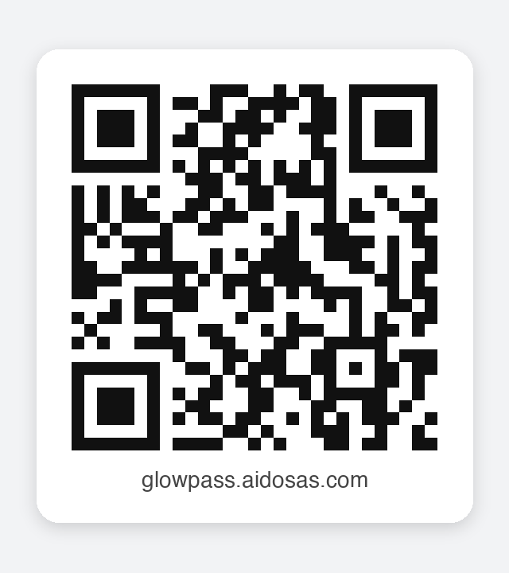

# GlowPass 안드로이드 앱 설치 안내 (2번 코드 · 시험용)

GlowPass 안드로이드 앱(2번 코드 · `android` 브랜치)은 1번 코드 서버(`app-glowpass.aidosas.com`)의 API 를 부르는 앱이다. 앱 설치 파일(APK)은 1번 코드 서버가 아래 주소로 내려준다.

| 받는 곳 | 주소 · QR |
|---|---|
| 앱 (APK) | `https://app-glowpass.aidosas.com/static/download/glowpass.apk` |
| 웹 | `https://glowpass.aidosas.com` |

- **웹 QR** (1번 코드 · 이 레포 `docs/qr/web-qr.png`)

  

- **앱 APK QR** 은 2번 코드(`android` 브랜치)의 `배포/qr/app-apk-qr.png` 에 있다 (QR 은 코드마다 하나씩, 주소가 적힌 판만 레포에 둔다)

## 1. 설치 (안드로이드 8.0 이상)

1. 휴대폰 카메라로 **앱 APK QR**(2번 코드 `배포/qr/app-apk-qr.png` · 디스코드 #glowpass-어플2번코드)을 찍고, 뜨는 주소를 누른다. (또는 휴대폰 크롬에서 위 주소를 연다)
2. `glowpass.apk` 받기가 끝나면 알림 또는 「다운로드」에서 파일을 누른다.
3. 「출처를 알 수 없는 앱 설치」를 묻는 경우, 그 앱(예: 크롬 · 파일)에 **허용** 을 켜고 돌아온다.
4. 「설치」를 누른다. Play 프로텍트가 경고하면 「세부정보 → 무시하고 설치」를 고른다. 시험용 디버그 서명이라 나오는 경고이다.
5. 앱을 열고 언어를 고른 뒤 회원가입 · 로그인한다.
6. 복약 알림을 처음 만들 때 알림 권한을 **허용** 한다. 정해진 시각에 정확히 받으려면 알림 화면의 「정확한 알람 허용하기」를 누른다.

## 2. 이미 설치한 경우 (새 판으로 바꾸기)

- 같은 주소에서 다시 받아 설치하면 **덮어 설치** 된다. 로그인 · 설정은 그대로 남는다.
- 「앱이 설치되지 않았습니다(서명 충돌)」가 나오면, 다른 컴퓨터에서 만든 시험판이 깔려 있는 경우이다 → 기존 GlowPass 앱을 지운 뒤 다시 설치한다.

## 3. 이 판 (2026-11-03)

| 항목 | 내용 |
|---|---|
| 판 | 2번 코드 총정리 (1번 코드 #43~#63 반영) · 패키지 `com.aidosas.glowpass.app` · 0.1.0 |
| 서버 | `https://app-glowpass.aidosas.com` (1번 코드 `main` · AWS 서울) |
| 크기 · SHA-256 | 약 31MB · `013ed3d285000abb31482c60aa1e9476abd1dbfbd4bea7beda25ef14f80d604d` |
| 서명 | 시험용 디버그 서명 (스토어 배포용 아님) |
| 디자인 | 기본 크림·모카 — 내 정보 → 「화면 디자인」에서 스카이블루·민트로 바꿀 수 있음 |

## 4. 새 판을 올리는 법 (개발자)

1. 2번 코드(`android`)에서 `./gradlew assembleAwsDebug` → `app/build/outputs/apk/aws/debug/app-aws-debug.apk`
2. 1번 코드 `frontend/download/glowpass.apk` 를 그 파일로 바꾸고, 이 문서의 SHA-256 을 고친 뒤 PR → 머지 → 자동 배포
3. QR · 주소는 바뀌지 않는다 (같은 이름으로 덮어쓰기)

> APK 를 서버 코드에 함께 두는 방식이라, 판을 바꿀 때마다 레포 크기가 약 31MB 씩 늘어난다. 판을 자주 바꾸게 되면 GitHub Releases 로 옮기는 것을 검토한다.
